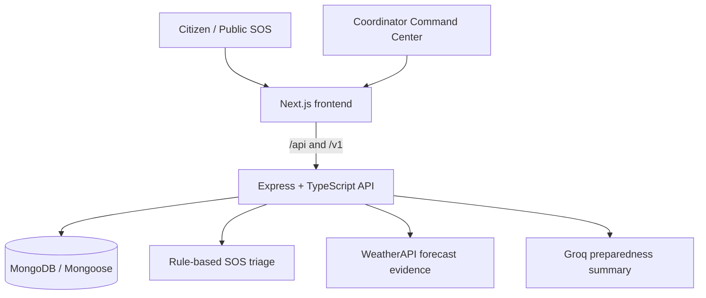

# ResQLink

<p align="center"></p>
<p align="center"><strong>Intelligent Disaster Response & Rescue Coordination Platform</strong></p>

ResQLink brings public emergency reporting, coordinator review, rescue-team coordination, and weather-informed preparedness into one operational workspace. Built by **Team Zyphora** for **CODE//CONNECT '26**.

<p align="center"><a href="https://resqlink-drab.vercel.app">Live application</a> · <a href="#getting-started">Local setup</a> · <a href="docs/architecture.md">Architecture</a> · <a href="docs/demo-guide.md">Judge demo guide</a></p>

> ResQLink is a hackathon prototype for coordination and decision support—not an official emergency dispatch service. Reports, weather signals, and preliminary urgency assessments require human review.

## Overview

Emergency response information can arrive through disconnected channels while coordinators need one view of reports, urgency, verification, available teams, assignments, and contextual weather signals. ResQLink supports a human-led workflow:

**Report → Review → Prioritize → Assign → Track → Resolve**

It records operational decisions; it does not autonomously dispatch responders or replace emergency authorities.

## Try ResQLink

**Live application:** [resqlink-drab.vercel.app](https://resqlink-drab.vercel.app)<br>
**API health:** [resqlink-backend-3agc.onrender.com/v1/health](https://resqlink-backend-3agc.onrender.com/v1/health)

- **Citizen portal:** use [Report an Emergency](https://resqlink-drab.vercel.app/sos). The public SOS flow accepts an emergency category, description, location selection, and immediate-danger answer without an account; it returns a report reference such as `RESQ-000123` after a successful submission.
- **Coordinator Command Center:** authorized coordinators can sign in to review incidents, teams, assignments, and preparedness information. Credentials are intentionally not published here.
- **Demo Mode:** the dashboard starts with fictional, in-browser records. Simulated status, verification, priority, assignment, and team-availability actions do not write to the production database and reset on a fresh session.
- **Real Data Mode:** retrieves saved backend records for authorized coordinators. Actions in this mode can persist, so it should be used responsibly.

For a safe walkthrough, see the [judge demo guide](docs/demo-guide.md). Do not submit test SOS reports or modify prepared records during evaluation.

## Core features

| Area | What is implemented |
| --- | --- |
| Public SOS reporting | A no-account SOS form with category, description, map/location input, immediate-danger answer, confirmation, and generated report reference. |
| Preliminary triage | Deterministic rule-based triage highlights a reported immediate threat and preserves uncertain or unanswered safety signals for review. It is not an AI dispatch system or emergency verification. |
| Incident command | Search; status, priority, and verification filtering; sorted queues; incident detail; status history; human verification; and auditable priority overrides. |
| Rescue coordination | Team management, capability/location-based recommendations, recorded assignments, and lifecycle changes. Distance is an approximate straight-line calculation—not routing or travel-time optimization. |
| Demo / Real separation | Fictional client-side scenarios are isolated from authenticated real-data API operations. |
| Community preparedness | Seven configured Sindh monitoring locations, WeatherAPI-backed forecast evidence when configured, review thresholds, and optional Groq-generated preparedness summaries. These are prototype decision-support signals, not official warnings or flood prediction. |

## How ResQLink works

1. A citizen submits an SOS report through the public form.
2. The backend validates the report, records a reference, applies preliminary rules, and flags possible duplicate or incomplete information for review.
3. A coordinator reviews the report, verification state, priority, and status history.
4. The coordinator chooses an eligible team after reviewing capability, availability, capacity warnings, and approximate distance.
5. The platform records the assignment and lifecycle changes. Resolving or cancelling an incident releases its active assigned team.

No mobile dispatch delivery, push notification, official authority integration, road routing, or automatic emergency action is implied by an assignment record.

## System architecture



Weather and Groq integrations are optional server-side configuration. The API preserves coordinator control over incident, verification, assignment, and preparedness decisions. More detail is in [docs/architecture.md](docs/architecture.md).

## Technology stack

| Layer | Verified technologies |
| --- | --- |
| Frontend | Next.js 16, React 19, TypeScript, Tailwind CSS 4, Leaflet, Recharts |
| Backend | Node.js, Express 4, TypeScript, Mongoose, Joi, JWT, Helmet, CORS |
| Data | MongoDB / MongoDB Atlas-compatible deployment |
| External intelligence | WeatherAPI.com forecast data; optional Groq analysis |
| Quality tooling | ESLint, Jest, Playwright, Prettier, TypeScript |
| Deployment | Vercel frontend; Render backend (live URLs above) |

## Getting started

Prerequisites: a current Node.js LTS release, npm, and a MongoDB replica set or Atlas cluster for lifecycle mutations. Run frontend and backend commands in separate terminals.

```bash
git clone https://github.com/SAADSAEED007/resqlink.git
cd resqlink
git switch dev
```

```bash
# terminal 1: frontend
cd frontend
npm ci
cp .env.example .env.local
npm run dev

# terminal 2: backend
cd backend
npm ci
cp .env.example .env
npm run start:dev
```

Open `http://localhost:3000`. The backend defaults to port `4000`. On Windows PowerShell, use `Copy-Item` in place of `cp` if preferred.

### Environment configuration

Service-specific examples are intentionally kept with the applications:

| File | Purpose |
| --- | --- |
| [`backend/.env.example`](backend/.env.example) | Database connection, token secrets, CORS origin, optional email, WeatherAPI, Groq, and prototype review thresholds. |
| [`frontend/.env.example`](frontend/.env.example) | Public build-time API and authentication base URLs only. |

Copy each file locally and supply your own values. Never commit `.env`, `.env.local`, database URLs, API keys, JWT secrets, or credentials. `NEXT_PUBLIC_*` values are visible in the browser, so secrets must never be placed there.

`WEATHERAPI_KEY` enables the configured weather provider. `GROQ_API_KEY` is needed only for the optional preparedness-summary action. `DEMO_MODE=true` and a separate `DEMO_DATABASE_URL` are required before the backend's opt-in `npm run seed:demo` command will run; do not use it against production data.

## Project structure

```text
backend/                 Express API, Mongoose models, services, Jest tests
  src/APIs/response/     SOS intake, triage, incidents, teams, assignments
  src/APIs/weather/      District monitoring and preparedness decisions
  src/APIs/riskZones/    Community risk-zone records and assessments
frontend/                Next.js public portal and coordinator workspace
  src/app/sos/           Public SOS route
  src/app/dashboard/     Incident, team, assignment, and risk-zone views
docs/                    Architecture, API contracts, demo and engineering notes
```

The [API contracts](docs/api-contracts.md) document the implemented endpoints and access requirements. Public access is limited to `POST /api/incidents`; coordinator routes require authenticated admin access.

## Testing and verification

```bash
cd backend
npm run build
npm test -- --runInBand

cd ../frontend
npm run typecheck
npm run lint
npm run build
```

Some integration tests require an isolated `TEST_DATABASE_URL`; builds may require local environment values. See [docs/verification.md](docs/verification.md) for historical verification notes rather than treating them as a live deployment guarantee.

## Current limitations and future scope

- ResQLink is not connected to emergency authorities, team mobile devices, SMS/WhatsApp, or push dispatch.
- SOS triage and weather thresholds are preliminary decision support; they are neither clinically validated nor official government warning systems.
- Rescue recommendations use capability checks and straight-line distance, not real-time traffic, routing, or responder telemetry.
- Weather monitoring covers seven configured representative Sindh districts and depends on provider availability; it is not comprehensive regional sensing or flood detection.
- Real-data operations require authorized coordinator access and a transaction-capable MongoDB deployment.

Potential future work includes field-team mobile workflows, controlled notification delivery, low-connectivity reporting, stronger anti-abuse controls, broader geospatial coverage, and official authority integrations—subject to appropriate governance.

## Team Zyphora

| Member | Role |
| --- | --- |
| Saad | Team Lead |
| Saba | Backend Development |
| Kulsoom | Frontend Development |
| Hafsah | Quality Assurance |

**Built for CODE//CONNECT '26.**
