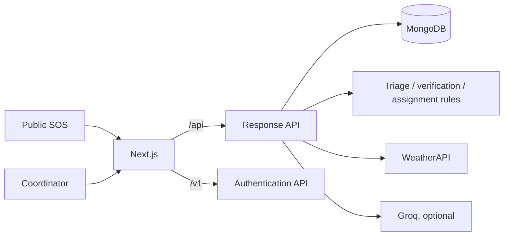

# ResQLink architecture

ResQLink has two independently configured applications: a Next.js frontend and an Express/TypeScript backend. The frontend serves both the public SOS experience and the authenticated coordinator workspace; the backend owns validation, persistence, access control, and operational rules.



## Incident lifecycle

```text
Citizen submits SOS
        ↓
Validation, report reference, preliminary rules
        ↓
Coordinator review and verification
        ↓
Capability and straight-line-distance team recommendation
        ↓
Coordinator confirms assignment
        ↓
Assigned → In progress → Resolved (or cancelled)
        ↓
Active assignment is closed and team is released
```

`POST /api/incidents` is the public SOS endpoint. It applies deterministic triage rules: a reported immediate threat can produce a preliminary critical suggestion; unclear or unanswered safety information remains explicitly uncertain. The service also records incomplete information and potential-duplicate signals for human review. These signals never automatically reject, merge, verify, or dispatch a report.

All subsequent incident, team, assignment, community-risk, and weather operations require the existing authenticated coordinator/admin role. Status changes, priority overrides, and verification decisions retain audit information. Assignment and lifecycle writes use MongoDB transactions; therefore Atlas or another replica-set deployment is required for these operations.

## Coordination boundaries

Recommendations require a suitable, available team and use approximate Haversine distance where coordinates are available. Capacity shortfalls or missing coordinates are surfaced for coordinator judgment. Recording an assignment is a platform record only: it does not deliver a mobile dispatch, estimate travel time, or prove that responders received an alert.

The dashboard’s default Demo Mode stores fictional records and simulated actions in the browser. It is intentionally isolated from real backend data. Real Data Mode polls authenticated backend records and can persist coordinator changes.

## Weather and preparedness

The weather module exposes seven configured representative monitoring locations in Sindh. With `WEATHERAPI_KEY` configured, it retrieves forecast evidence and attaches provider timestamps and freshness information. Configurable precipitation thresholds create prototype review levels. Coordinators may record a preparedness decision against already retrieved evidence.

When `GROQ_API_KEY` is configured, the service can generate a preparedness summary grounded in the selected forecast and local records. Neither the forecast, thresholds, nor the AI summary is an official warning, flood prediction, sensor feed, or automated dispatch instruction.

## Security and configuration

The API applies Helmet, CORS with explicit trusted origins, JSON body limits, cookies, rate limiting, and coordinator authorization. Backend configuration belongs in `backend/.env`; browser-visible URL configuration belongs in `frontend/.env.local`. Secrets must not be committed or placed in `NEXT_PUBLIC_*` variables.

For endpoint details, see [API contracts](api-contracts.md). For a non-mutating evaluation path, see the [judge demo guide](demo-guide.md).
